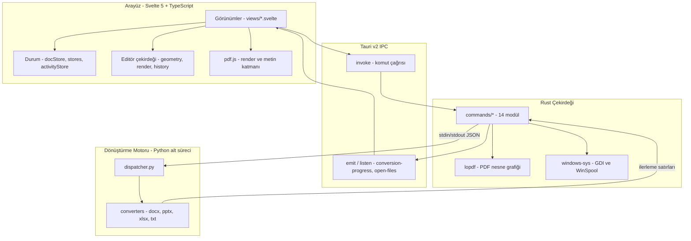
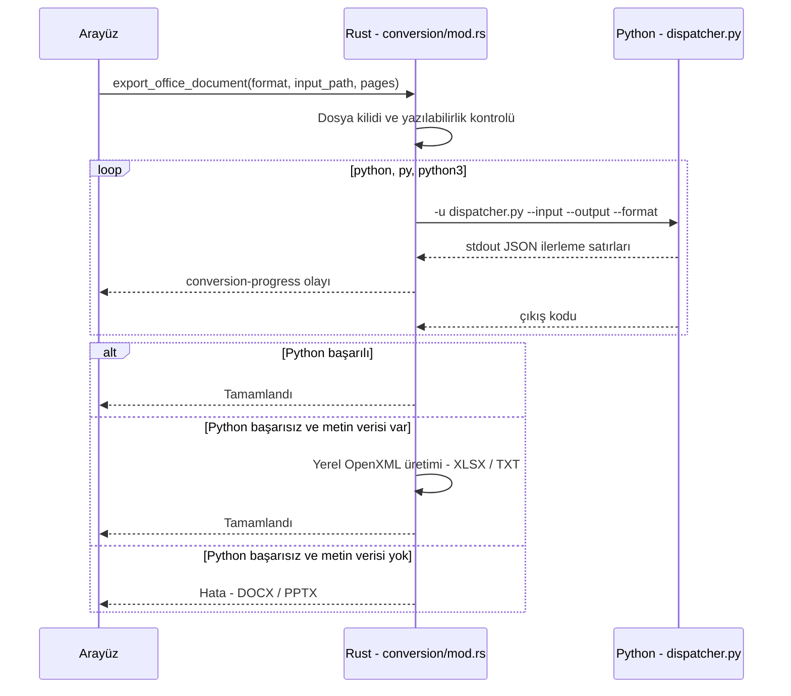

# PDFkit — Teknik Dokümantasyon

> **Sürüm:** 0.1.0 · **Platform:** Windows 10 / 11 (x64) · **Lisans:** AGPL-3.0-or-later
> **Yığın:** Tauri v2 · Rust 2021 (`lopdf`) · Svelte 5 + TypeScript + Vite + TailwindCSS · `pdf.js` · Python (isteğe bağlı dönüştürme motoru)

Bu belge PDFkit'in mimarisini, modüllerini, IPC sözleşmesini ve çekirdek algoritmalarını açıklar. Kullanıcıya yönelik tanıtım için [README.md](README.md) dosyasına bakın.

---

## İçindekiler

1. [Genel Bakış](#1-genel-bakış)
2. [Sistem Gereksinimleri](#2-sistem-gereksinimleri)
3. [Geliştirici Ortamı](#3-geliştirici-ortamı)
4. [Mimari](#4-mimari)
5. [Dizin Yapısı](#5-dizin-yapısı)
6. [IPC Komut Referansı](#6-ipc-komut-referansı)
7. [Çekirdek Algoritmalar](#7-çekirdek-algoritmalar)
8. [Office Dönüştürme Motoru](#8-office-dönüştürme-motoru)
9. [Güvenlik Modeli](#9-güvenlik-modeli)
10. [Geliştirme Rehberi](#10-geliştirme-rehberi)
11. [Bilinen Sınırlamalar](#11-bilinen-sınırlamalar)

---

## 1. Genel Bakış

PDFkit, yerel (local-first) çalışan bir masaüstü PDF uygulamasıdır. Üç katmandan oluşur:

| Katman | Teknoloji | Sorumluluk |
| :--- | :--- | :--- |
| **Arayüz** | Svelte 5, TypeScript, `pdf.js` | Sayfa render, düzenleme tuvali, kullanıcı etkileşimi |
| **Çekirdek** | Rust, `lopdf`, `windows-sys` | PDF nesne grafiği üzerinde tüm yapısal işlemler, şifreleme, yazdırma |
| **Dönüştürme** | Python alt süreci (isteğe bağlı) | PDF → DOCX / PPTX / XLSX / TXT yüksek sadakatli dönüşüm |

Tüm PDF işlemleri (birleştirme, ayırma, döndürme, sıkıştırma, şifreleme, filigran, sansür, form, yazdırma) Rust çekirdeğinde süreç içi (in-process) çalışır ve harici bir çalışma zamanı gerektirmez. Python yalnızca Office dönüşümü için kullanılır.

---

## 2. Sistem Gereksinimleri

### 2.1. Çalışma Ortamı

| Bileşen | Gereksinim | Not |
| :--- | :--- | :--- |
| İşletim sistemi | Windows 10 / 11, x64 | |
| WebView2 Runtime | Gerekli | Windows 11 ve güncel Windows 10'da yüklü gelir. Yoksa kurulum sırasında indirilir. |
| Python 3.10+ | **İsteğe bağlı** | Yalnızca Word / PowerPoint dönüşümü ve Excel / TXT'nin gelişmiş modu için |

### 2.2. Disk Kullanımı

| Bileşen | Boyut |
| :--- | ---: |
| NSIS kurulum paketi (`PDFkit_0.1.0_x64-setup.exe`) | ~4.1 MB |
| MSI kurulum paketi (`PDFkit_0.1.0_x64_en-US.msi`) | ~5.0 MB |
| Kurulu uygulama (`pdfkit.exe` + `scripts/`) | ~14 MB |
| Python yorumlayıcısı (isteğe bağlı) | ~100–150 MB |
| Dönüştürme paketleri: PPTX / XLSX / TXT için | ~82 MB |
| Dönüştürme paketleri: DOCX için ek | ~186 MB |

> DOCX dönüşümünü sağlayan `pdf2docx`, bağımlılık olarak `opencv-python-headless` (~112 MB) ve `numpy` (~52 MB) getirir. Tüm dönüştürme yığını (Python + paketler) yaklaşık **400 MB** yer kaplar.

### 2.3. Python Bağımlılıkları

| Paket | Kullanıldığı motor |
| :--- | :--- |
| `pymupdf` | Tüm motorlar (PDF okuma, metin/geometri çıkarımı) |
| `pdf2docx`, `python-docx` | DOCX |
| `python-pptx` | PPTX |
| `xlsxwriter` | XLSX |

Kurulum:

```powershell
winget install -e --id Python.Python.3.13
py -m pip install pymupdf pdf2docx python-docx python-pptx xlsxwriter
```

İnternet erişimi olmayan makineler için paketler başka bir makinede indirilip taşınabilir:

```powershell
# İnternet erişimi olan makinede
py -m pip download pymupdf pdf2docx python-docx python-pptx xlsxwriter -d .\wheels

# Hedef makinede (çevrimdışı)
py -m pip install --no-index --find-links .\wheels pymupdf pdf2docx python-docx python-pptx xlsxwriter
```

> Hedef makinedeki Python sürümü ve mimarisi, paketlerin indirildiği makineyle aynı olmalıdır.

### 2.4. Python Bulunamadığında Davranış

| Format | Python varsa | Python yoksa |
| :--- | :--- | :--- |
| DOCX | `pdf2docx` ile yüksek sadakatli dönüşüm | Hata döner |
| PPTX | Geometrik analizli slayt inşası | Hata döner |
| XLSX | `pymupdf` + `xlsxwriter` | Rust içinde, metin tabanlı OpenXML üretimi |
| TXT | `pymupdf` ile metin çıkarımı | Rust içinde, `pdf.js` metin katmanından üretim |

---

## 3. Geliştirici Ortamı

### 3.1. Araçlar

| Araç | Sürüm |
| :--- | :--- |
| Node.js | 18+ |
| Rust | 1.77+ (`rust-version`, `Cargo.toml`) |
| MSVC Build Tools | "Desktop development with C++" iş yükü |
| Python | 3.10+ (yalnızca dönüştürme motoru ve testleri için) |

### 3.2. Komutlar

```bash
git clone https://github.com/Chady1Dev/PDFKit.git
cd PDFKit
npm install

# Geliştirme (Vite HMR + Tauri)
npm run tauri dev

# Rust testleri
cargo test --manifest-path src-tauri/Cargo.toml

# Python motor testleri (proje kökünden)
python -m unittest discover -s tests -t .

# Release derlemesi
npm run build:app
```

### 3.3. Derleme Çıktıları

| Dosya | Açıklama |
| :--- | :--- |
| `src-tauri/target/release/pdfkit.exe` | Taşınabilir çalıştırılabilir dosya |
| `src-tauri/target/release/bundle/nsis/PDFkit_0.1.0_x64-setup.exe` | Kurulum sihirbazı |
| `src-tauri/target/release/bundle/msi/PDFkit_0.1.0_x64_en-US.msi` | Kurumsal dağıtım paketi |

> MSI üretimi için `tauri.conf.json` içindeki `bundle.targets` listesinde `"msi"` bulunmalıdır.

### 3.4. Release Profili

`Cargo.toml` içindeki release profili boyut ve hız için optimize edilmiştir: `lto = true`, `codegen-units = 1`, `opt-level = 3`, `strip = true`.

---

## 4. Mimari

### 4.1. Katman Şeması



### 4.2. Tasarım Kararları

**Tauri v2 (Electron yerine):** Electron her uygulamaya Chromium ve Node.js gömer. Tauri, Windows'un sistem genelinde paylaşılan WebView2 bileşenini kullanır; bu sayede kurulum paketi ~4 MB'ta kalır.

**Rust + `lopdf`:** PDF nesne grafiği üzerinde düşük seviyeli işlemler (içerik akışı ayrıştırma, nesne budama, şifreleme) için bellek güvenli ve çöp toplayıcısız bir ortam sağlar. Her komut belgeyi yükler, işler ve IPC yanıtından önce bırakır (`drop`).

**Svelte 5:** Sanal DOM katmanı olmadan derlenen reaktif bileşenler, sürekli kaydırmalı çok sayfalı tuval görünümünde düşük ek yük sağlar.

**Python alt süreci:** PDF'ten Office formatlarına dönüşüm; font metrikleri, satır kümeleme ve tablo algılama gibi geometri analizleri gerektirir. Bu alanda olgun kütüphaneler (`PyMuPDF`, `pdf2docx`, `python-pptx`) Python ekosisteminde bulunur. Motor ayrı bir süreçte çalıştığı için çökmesi veya iptal edilmesi ana uygulamayı etkilemez.

---

## 5. Dizin Yapısı

```
PDFKit/
├── src/                                  # Arayüz (Svelte 5 + TypeScript)
│   ├── App.svelte                        # Ana kabuk, sekmeler, kısayollar
│   ├── main.ts
│   └── lib/
│       ├── api.ts                        # Rust IPC komutlarının TypeScript sarmalayıcıları
│       ├── pdf.ts                        # pdf.js entegrasyonu (render, metin, form, link)
│       ├── docStore.ts                   # Çoklu belge durumu ve açıklama (annotation) modeli
│       ├── stores.ts                     # Bildirimler, sürükle-bırak kuyruğu
│       ├── activityStore.ts              # İşlem geçmişi
│       ├── recentFiles.ts                # Son açılan dosyalar (localStorage)
│       ├── selection.ts
│       ├── editor/
│       │   ├── geometry.ts               # Sınır kutusu, isabet testi, kenar tutma
│       │   ├── render.ts                 # Tuval çizimi (şekil, ok, sansür, metin)
│       │   └── history.ts                # Geri al / yinele yığını
│       ├── components/                   # ContinuousPage, SidebarPageThumb, PrintModal,
│       │                                 # ExportConvertModal, SignaturePadModal, PdfSearchBar ...
│       └── views/
│           ├── Dashboard.svelte
│           ├── EditorView.svelte         # Düzenleme, sansür, imza, kaydetme akışı
│           ├── AnnotateView.svelte       # Filigran ekle/kaldır, sayfa numarası
│           ├── ImagesView.svelte         # Görsel ↔ PDF, Office dışa aktarma
│           ├── MergeView / SplitView / RotateView / OrganizeView.svelte
│           ├── CompressView.svelte
│           ├── SecurityView.svelte
│           └── ActivityView.svelte
│
├── src-tauri/                            # Rust çekirdeği
│   ├── Cargo.toml
│   ├── tauri.conf.json                   # Pencere, CSP, paketleme, dosya ilişkilendirme
│   ├── capabilities/default.json         # Tauri izin seti
│   ├── templates/blank.pptx              # Rust PPTX üretimi için temel paket
│   ├── scripts/                          # Uygulamayla birlikte dağıtılan kaynaklar
│   │   ├── pdf2docx_engine.py            # Geriye dönük uyumlu giriş noktası
│   │   ├── ocr_engine.ps1                # Windows.Media.Ocr köprüsü
│   │   └── python_engine/
│   │       ├── dispatcher.py             # Format yönlendirici (lazy import)
│   │       ├── common/                   # Doğrulama, ilerleme, hata çıktısı
│   │       └── converters/{docx,pptx,xlsx,txt}/
│   ├── tests/integration.rs
│   └── src/
│       ├── lib.rs                        # Tauri başlatıcı, eklentiler, komut kaydı
│       ├── main.rs
│       ├── error.rs                      # PdfError (thiserror)
│       ├── pdfutil.rs                    # Kalıtsal özellikler, MediaBox, font yardımcıları
│       ├── types.rs                      # Paylaşılan sonuç tipleri
│       └── commands/
│           ├── annotate.rs               # Filigran, sayfa numarası, editör katmanları, sansür
│           ├── compress.rs
│           ├── convert_office.rs         # Dönüştürme komut cephesi
│           ├── conversion/               # mod.rs (Python köprüsü) + docx/pptx/xlsx/txt.rs
│           ├── document.rs               # Meta veri, Explorer entegrasyonu, dosya okuma
│           ├── forms.rs                  # AcroForm okuma/doldurma, görsel damgalama
│           ├── images.rs                 # Görsel → PDF
│           ├── merge.rs / split.rs / rotate.rs / organize.rs
│           ├── ocr.rs                    # Windows OCR + aranabilir metin katmanı
│           ├── printer.rs                # Win32 GDI doğrudan yazdırma
│           └── security.rs               # AES şifreleme / şifre çözme
│
├── python_engine/                        # Testlerin kullandığı motor kopyası
└── tests/                                # Python motor testleri (unittest)
```

> `python_engine/` (kök) ile `src-tauri/scripts/python_engine/` aynı içeriğe sahiptir. Uygulama ikincisini dağıtır. Değişiklikler her iki konumda senkron tutulmalıdır.

---

## 6. IPC Komut Referansı

Tüm komutlar `src-tauri/src/lib.rs` içinde `generate_handler!` ile kaydedilir ve `src/lib/api.ts` üzerinden çağrılır. Uzun süren işlemler `spawn_blocking` ile arayüz iş parçacığını bloklamadan çalışır.

| Modül | Komutlar |
| :--- | :--- |
| `lib.rs` | `exit_app`, `get_cli_args` |
| `document` | `get_pdf_info`, `reveal_in_explorer`, `read_binary_file` |
| `merge` / `split` / `rotate` / `organize` | `merge_pdfs`, `split_pdf`, `rotate_pages`, `organize_pdf` |
| `images` | `images_to_pdf`, `write_binary_file` |
| `compress` | `compress_pdf` |
| `security` | `encrypt_pdf`, `decrypt_pdf` |
| `annotate` | `add_watermark`, `remove_watermark`, `remove_watermark_bytes`, `write_pdf_bytes`, `add_page_numbers`, `stamp_page_overlays`, `load_editor_document` |
| `printer` | `get_system_printers`, `open_printer_properties`, `direct_print_pages` |
| `forms` | `list_form_fields`, `fill_form`, `stamp_image` |
| `convert_office` | `export_office_document`, `cancel_conversion` |
| `ocr` | `ocr_image`, `add_searchable_ocr_layer` |

**Olaylar (events):**

| Olay | Yön | Açıklama |
| :--- | :--- | :--- |
| `conversion-progress` | Rust → Arayüz | `{ current, total, percent, stage }` |
| `open-files` | Rust → Arayüz | Tek örnek (single-instance) kilidi; ikinci açılıştaki dosya yolları mevcut pencereye iletilir |

---

## 7. Çekirdek Algoritmalar

### 7.1. Filigran Temizleme (`annotate.rs`)

Sayfanın içerik akışı `lopdf::content::Content::decode` ile operatör listesine ayrıştırılır ve `BT … ET` blokları ile XObject çağrıları tek tek değerlendirilir.

**Filigran sinyalleri** (`is_block_watermark_context`):
- Döndürülmüş metin matrisi (`cm` / `Tm` operatörlerinde çapraz dönüşüm)
- Saydamlık için grafik durumu (`gs`)
- `BDC` / `BMC` işaretli içerik etiketleri (`Artifact`, `Watermark`, `OC` vb.)
- Adı `watermark`, `filigran` veya `stamp` içeren XObject çağrıları (`Do`)

**Bölge tespiti** (`determine_block_zone`): Bloğun dikey konumu sayfa yüksekliğine oranlanır.

| Bölge | Koşul |
| :--- | :--- |
| Center | Çapraz matris içeren tüm bloklar |
| Top | `rel_y ≥ 0.82` |
| Bottom | `rel_y ≤ 0.16` |
| Center | Diğer durumlar |

Koordinat çıkarılamazsa anahtar kelime sezgilerine (`is_top_watermark_text`, `is_bottom_watermark_text`) düşülür. Kullanıcı bölgeleri ayrı ayrı seçebilir. Ek olarak sayfa numarası desenleri (`is_page_number_pattern`) ayrı bir temizleme adımıyla (`clean_page_numbers`) kaldırılabilir.

Filigran içeren Form XObject'ler sayfanın `/Resources` sözlüğünden silinir (`find_and_remove_watermark_xobjects`), değiştirilen içerik akışları yeniden sıkıştırılarak kaydedilir. `remove_watermark_bytes` aynı işlemi bellek üzerindeki belge baytlarına uygular; editör bu yolla diske yazmadan önizleme yapar.

### 7.2. Kalıcı Sansürleme (`EditorView.svelte` + `annotate.rs::apply_overlays`)

Sansür kutusu yalnızca görsel bir örtü değildir. Kaydetme sırasında:

1. Sansür içeren her sayfa `pdf.js` ile **2.5x ölçekte** (~180 DPI) render edilir.
2. Sansür kutuları bu görüntünün piksellerine yakılır ve PNG olarak Rust'a gönderilir (`replace_page_content: true`).
3. Rust, sayfanın `/Contents` akışını **tamamen** bu görüntüyü çizen yeni bir akışla değiştirir ve `/Annots` girdisini kaldırır.
4. Belge bilgi sözlüğü (`/Info`) ve XMP meta verisi (`/Metadata`) silinir.
5. `prune_objects()` ile artık referans verilmeyen eski içerik akışları, fontlar ve kaynaklar dosyadan budanır.
6. `lopdf` dosyayı artımlı güncelleme (incremental update) olmadan baştan yazar; eski revizyonlar dosyada kalmaz.

Sonuç olarak sansürlenen sayfada orijinal metin operatörleri (`Tj`, `TJ`) ve glif verisi bulunmaz; metin seçilemez, aranamaz ve geri getirilemez.

> **Ödünleşim:** Sansür uygulanan sayfanın tamamı görüntüye dönüşür; o sayfadaki sansürlenmemiş metin de seçilemez hale gelir. Diğer sayfalar etkilenmez. Sansürlü belge varsayılan olarak `_cencored` son ekiyle ayrı bir dosyaya kaydedilir; orijinalin üzerine yazılmaz.

### 7.3. Editör Katmanları ve Yeniden Düzenlenebilirlik

Sansür dışındaki açıklamalar (metin, şekil, vurgulama, imza, görsel) şeffaf bir PNG katmanı olarak sayfaya eklenir:

- Açıklamaların sınır kutusu sayfanın %85'inden küçükse katman bu kutuya kırpılır; dosya boyutu düşük tutulur.
- Katman, `PDFKit_Overlay` işaretli ayrı bir içerik akışı olarak sayfanın `/Contents` dizisine eklenir; akış kimlikleri katalogda `PDFKit_OverlayStreams` altında tutulur.
- Editör durumunun JSON hali katalogda `PDFKit_EditorData` akışına yazılır.
- Belge yeniden açıldığında `load_editor_document` JSON'u geri okur; yeniden kaydedilirken `strip_pdfkit_overlays` eski katmanları kaldırır. Böylece düzenlemeler üst üste birikmez ve belge PDFkit'te düzenlenebilir kalır.

### 7.4. Sürekli Kaydırma ve Çift Tuval Modeli

Editörde tüm sayfalar tek bir dikey kapsayıcıda akar. Her sayfa iki tuvalden oluşur:

- **Alt tuval:** `pdf.js` tarafından render edilen sayfa içeriği
- **Üst tuval:** Kullanıcı çizimleri, seçim çerçeveleri ve tutamaçlar

Şekil seçimi (`geometry.ts`) dolgusuz şekillerde yalnızca kenar çizgisine duyarlıdır; böylece şeklin içindeki metin seçilebilir kalır. Bir nesne kenar çubuğundaki başka bir sayfa küçük resmine sürüklendiğinde hedef sayfanın merkezine taşınır ve görünüm o sayfaya kaydırılır.

### 7.5. Sıkıştırma (`compress.rs`)

| Seviye | İşlem |
| :--- | :--- |
| `lossless` | `/Info` ve XMP meta verisini kaldırır, sıfır uzunluklu akışları ve sahipsiz nesneleri budar, akışları Flate ile sıkıştırır |
| `balanced` | `lossless` + görselleri en fazla 1600 px'e küçültüp JPEG %75 kaliteyle yeniden kodlar |
| `maximum` | `lossless` + görselleri en fazla 1000 px'e küçültüp JPEG %50 kaliteyle yeniden kodlar |

Bir görsel yalnızca yeni kodlaması orijinalinden küçükse değiştirilir. Çıktı önce geçici dosyaya yazılır; sonuç orijinalden küçük değilse hedef dosya oluşturulmaz ve `already_optimized: true` döner.

### 7.6. Şifreleme (`security.rs`)

| Algoritma | Standart |
| :--- | :--- |
| **AES-256** (varsayılan) | Standard Security Handler V5 (PDF 2.0 / ISO 32000-2) |
| AES-128 | Standard Security Handler V4 |

- Kullanıcı (açılış) ve sahip (izin) parolaları ayrıdır; sahip parolası boşsa kullanıcı parolası kullanılır.
- İzinler: yazdırma, kopyalama, değiştirme, açıklama/form doldurma. Erişilebilirlik için kopyalama izni her zaman açık bırakılır.
- Dosya kimliği (`/ID`) ve AES-256 dosya anahtarı işletim sisteminin rastgele sayı kaynağından (`getrandom`) üretilir.
- Şifre çözme `Document::load_with_password` ile yapılır; hatalı parola yükleme aşamasında reddedilir.

### 7.7. Formlar (`forms.rs`)

- AcroForm alanları okunur, doldurulur ve görünüm akışları (appearance stream) üretilir.
- ASCII dışı değerler PDF spesifikasyonu gereği BOM'lu UTF-16BE olarak kodlanır.
- Türkçe karakterlerin tüm görüntüleyicilerde doğru çizilmesi için sistemdeki bir TrueType font, `/Type0` + `/Identity-H` + `/ToUnicode` CMap ile gömülür; mümkün olmazsa WinAnsi (CP1254) yedeğine düşülür.
- `stamp_image`, taranmış imza gibi bir görseli PDF koordinatlarında belirtilen dikdörtgene damgalar.

### 7.8. Doğrudan Yazdırma (`printer.rs`)

Tarayıcı yazdırma penceresi kullanılmaz. Sayfalar arayüzde PNG olarak render edilir ve Rust'a gönderilir. Rust:

1. `EnumPrintersW` / `GetDefaultPrinterW` ile yazıcıları listeler.
2. `CreateDCW("WINSPOOL", yazıcı)` ile aygıt bağlamı açar.
3. `GetDeviceCaps` ile DPI ve basılabilir alanı okur, kenar boşluklarını milimetreden noktaya çevirir.
4. Her sayfayı en-boy oranını koruyarak sığdırır ve `StretchDIBits` ile yazdırır. Gri tonlama ve kopya sayısı desteklenir.

`open_printer_properties`, sürücünün kendi ayar penceresini (`DocumentPropertiesW`) açar.

### 7.9. OCR (`ocr.rs`)

Windows'un yerleşik `Windows.Media.Ocr` motoru, `scripts/ocr_engine.ps1` üzerinden PowerShell ile çağrılır. Harici bir OCR motoru gerekmez. `add_searchable_ocr_layer`, tanınan kelimeleri görünmez metin modunda (`3 Tr`) sayfaya ekleyerek taranmış belgeleri aranabilir yapar.

> Bu komutlar backend'de mevcuttur ancak 0.1.0 sürümünde arayüze bağlı değildir.

---

## 8. Office Dönüştürme Motoru

### 8.1. Süreç Akışı



- Yorumlayıcı sırasıyla `python`, `py`, `python3` olarak aranır; ilk başarılı çalışan kullanılır.
- Alt süreç `CREATE_NO_WINDOW` bayrağıyla konsol penceresi açmadan başlatılır.
- İptal edildiğinde süreç ağacı `taskkill /F /T` ile sonlandırılır ve yarım kalmış çıktı dosyası silinir.
- Python motoru her satıra tek bir JSON nesnesi yazar: `progress`, `success` veya `error`.

### 8.2. Motor Yapısı

`dispatcher.py` girdiyi doğrular ve yalnızca istenen formatın motorunu içe aktarır (lazy import). Böylece örneğin PPTX dönüşümü için `pdf2docx` ve bağımlılıkları yüklenmez.

| Motor | Kütüphaneler | Yaklaşım |
| :--- | :--- | :--- |
| `docx` | `pdf2docx`, `python-docx`, `pymupdf` | `pdf2docx` dönüştürücüsü + çalışma zamanı yamaları |
| `pptx` | `pymupdf`, `python-pptx` | Sayfa analizi → ara temsil (IR) → slayt inşası |
| `xlsx` | `pymupdf`, `xlsxwriter` | Tablo/metin çıkarımı → çalışma sayfası |
| `txt` | `pymupdf` | Okuma sırasına göre metin çıkarımı |

### 8.3. DOCX: Çalışma Zamanı Yamaları (`converters/docx/patches.py`)

**`patch_docx_table_performance`:** `python-docx` içinde `Table._cells` özelliği her `table.cell(r, c)` çağrısında tablonun tüm hücre ızgarasını XML üzerinden yeniden hesaplar. Kenarlık çizimi gibi hücre başına çok sayıda çağrı yapan işlemlerde bu, tablo boyutuyla karesel büyüyen bir maliyete dönüşür. Yama, ızgarayı tablo nesnesi başına bir kez hesaplayıp önbelleğe alır:

```python
def patch_docx_table_performance():
    from docx.table import Table
    orig_cells = Table._cells.fget

    def fast_cells(self):
        cache = getattr(self, "_cached_cells_grid", None)
        if cache is None:
            cache = orig_cells(self)
            self._cached_cells_grid = cache
        return cache

    Table._cells = property(fast_cells)
```

İlk erişimden sonra hücre araması sabit zamanlı hale gelir. Tablolu 8 sayfalık bir sınav belgesi üzerindeki ölçümde dönüşüm süresi dakikalardan ~8 saniyeye inmiştir.

**`patch_pdf2docx_unicode`:** Türkçe karakterlerde kelime sınırlarının ve Unicode eşleşmelerinin korunmasını sağlar.

**`patch_pdf2docx_layout_protection`:** Karmaşık düzenlerde sayfa yapısının bozulmasını önler.

**`StreamProgressHandler`:** `pdf2docx` log kayıtlarını yakalayıp sayfa bazlı JSON ilerleme satırlarına çevirir.

### 8.4. PPTX: Geometrik Yeniden İnşa (`converters/pptx/`)

| Dosya | Sorumluluk |
| :--- | :--- |
| `analyzer.py` | `PageAnalyzer`: metin parçaları, fontlar, görseller, tablolar ve şekillerin çıkarımı |
| `ir.py` | Ara temsil: `Page`, `TextBlock`, `TextLine`, `TextSpan`, `Table`, `Shape`, `Diagram` |
| `layout.py` | Satır kümeleme, blok gruplama, sütun ayrımı tespiti, tire birleştirme, metin kutusu ölçüleri |
| `quality.py` | `QualityAuditor`: IR üzerinde tutarlılık denetimi ve otomatik düzeltme |
| `pptx_builder.py` | `PptxSlideBuilder`: IR'dan konumlandırılmış metin kutuları, tablolar ve görseller üretir |

Önemli adımlar:
- Slayt boyutu ilk sayfanın boyutundan türetilir; çok büyük veya çok küçük sayfalar ölçeklenir.
- Yapı ağacı (`StructTreeRoot`) ve `/ActualText` / `/MCID` işaretleri bellek içinde etkisizleştirilir; böylece erişilebilirlik metinleri slaytlarda "hayalet" metin olarak görünmez.
- Açılı (çapraz) metinler sütun algılamasından izole edilir; iki sütunlu sayfalar dikey eksene göre iki bağımsız metin akışına bölünür.

### 8.5. Rust Yedek Üreticileri (`conversion/*.rs`)

Python kullanılamadığında XLSX ve TXT için `pdf.js` metin katmanından alınan sayfa metinleriyle Rust içinde geçerli OpenXML paketleri (`zip` crate) veya BOM'lu UTF-8 metin dosyası üretilir. Sekme içeren satırlar tablo olarak yorumlanır. `docx.rs` ve `pptx.rs` aynı üreticileri içerir; ancak arayüz bu formatlarda sayfa metni göndermediği için Python olmadan devreye girmezler.

---

## 9. Güvenlik Modeli

### 9.1. Ağ İzolasyonu

`tauri.conf.json` içindeki İçerik Güvenlik Politikası:

```
default-src 'self'; script-src 'self' 'wasm-unsafe-eval'; style-src 'self' 'unsafe-inline';
img-src 'self' blob: data:; font-src 'self'; connect-src 'self'; object-src 'none';
frame-src 'none'; base-uri 'self';
```

- `connect-src 'self'` ile arayüzden dış adreslere `fetch` / XHR / WebSocket isteği yapılamaz.
- Tüm fontlar ve görseller pakete gömülüdür; harici CDN kullanılmaz.
- Uygulamada güncelleme eklentisi, telemetri veya analitik kodu bulunmaz.
- Rust çekirdeği ağ kütüphanesi içermez.

### 9.2. Başlatılan Harici Süreçler

| Süreç | Amaç | Ne zaman |
| :--- | :--- | :--- |
| `python` / `py` / `python3` | Office dönüştürme motoru | Yalnızca dönüştürme sırasında |
| `taskkill` | Dönüştürme iptali | Kullanıcı iptal ettiğinde |
| `explorer.exe` | Dosyayı klasörde göster | Kullanıcı istediğinde |
| `powershell` | Windows OCR köprüsü | OCR komutu çağrıldığında |

### 9.3. Tauri İzinleri

`capabilities/default.json` yalnızca ana pencere için şu izinleri tanımlar: `core` (pencere, olaylar), `dialog` (dosya aç/kaydet) ve `fs:default`.

### 9.4. Bellek ve Geçici Dosyalar

- Her Rust komutu `lopdf::Document` nesnesini işlem bitmeden bırakır.
- Sıkıştırma ve yerinde kaydetme işlemleri önce geçici dosyaya yazar, ardından hedefe taşır; yarım yazılmış dosya oluşmaz.

---

## 10. Geliştirme Rehberi

### 10.1. Yeni Bir Rust Komutu Eklemek

1. `src-tauri/src/commands/` altında modülü oluşturun veya genişletin.
2. Komutu tanımlayın; disk veya CPU yoğun işleri `spawn_blocking` içine alın:

   ```rust
   #[tauri::command]
   pub async fn my_command(input: String, output: String) -> Result<OpResult, PdfError> {
       tauri::async_runtime::spawn_blocking(move || {
           let mut doc = Document::load(&input)?;
           if doc.is_encrypted() {
               return Err(PdfError::Encrypted);
           }
           // ... işlem ...
           doc.save(&output)?;
           Ok(OpResult { outputs: vec![output], total_pages: 0, total_size_bytes: 0 })
       })
       .await
       .map_err(|e| PdfError::TaskJoin(e.to_string()))?
   }
   ```

3. `commands/mod.rs` içine modülü, `lib.rs` içindeki `generate_handler![]` listesine komutu ekleyin.
4. `src/lib/api.ts` içine TypeScript karşılığını ekleyin:

   ```typescript
   export const myCommand = (input: string, output: string) =>
     invoke<OpResult>("my_command", { input, output });
   ```

### 10.2. Yeni Bir Dönüştürme Formatı Eklemek

1. `scripts/python_engine/converters/<format>/engine.py` içinde `convert_pdf_to_<format>()` fonksiyonunu yazın; ilerleme için `emit_progress`, hata için `emit_error` kullanın.
2. `dispatcher.py` içindeki format listesine ve yönlendirmeye ekleyin.
3. `src-tauri/src/commands/conversion/` altında Rust modülünü ve `convert_office.rs` içindeki eşleşmeyi ekleyin.
4. Değişiklikleri kök dizindeki `python_engine/` kopyasına da yansıtın ve `tests/` altına test ekleyin.

### 10.3. Kurallar

1. **Dönüştürme motorunu regresyona karşı test edin.** `pdf2docx_engine.py` ve `python_engine/` üzerindeki her değişiklikte iki sütunlu ve tablolu bir örnek belgeyle dönüşümü doğrulayın.
2. **Şekil seçimi kenar odaklı kalmalı.** `geometry.ts` içindeki isabet testi dolgusuz şekillerde iç alanı yakalamamalıdır.
3. **Belgeler kısa ömürlü olmalı.** `lopdf::Document` nesneleri komut sonunda kapsam dışına çıkmalıdır.
4. **Ağ erişimi eklemeyin.** CSP'yi gevşetmek veya ağ kütüphanesi eklemek projenin temel güvenlik taahhüdünü bozar.

---

## 11. Bilinen Sınırlamalar

| Konu | Durum |
| :--- | :--- |
| Python bağımlılığı | Word / PowerPoint dönüşümü sistemde Python ve paketlerin kurulu olmasını gerektirir. |
| Sansürlü sayfalar | Sansür uygulanan sayfa görüntüye dönüşür; o sayfadaki metin seçilemez. |
| Kod imzalama | Yürütülebilir dosyalar imzasız olduğundan SmartScreen uyarısı gösterilebilir. |
| OCR | Backend'de mevcut, arayüze bağlı değil. |
| Platform | Yalnızca Windows x64 derlemesi sunulur. Yazdırma modülü Win32 API'ye bağlıdır. |
| Lisans uyumu | `PyMuPDF` AGPL-3.0 lisanslıdır; PDFkit'in AGPL-3.0 lisansı bu bağımlılıkla uyumludur. |
