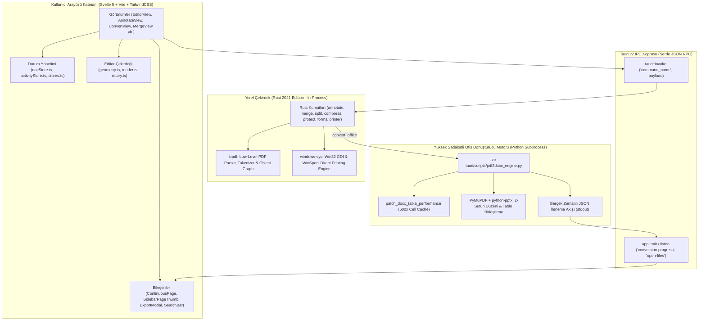

# PDFKit — Sistem Mimarisi, Fonksiyonel ve Teknik Dökümantasyon (Master Reference)

> **Sürüm:** 0.1.0-release  
> **Tarih:** Ekim 2026  
> **Hedef Platform:** Windows 10 / 11 (x64) — İleride macOS / Linux genişletilebilir  
> **Mimari:** Tauri v2 + Rust (lopdf) + Svelte 5 / Vite + PyMuPDF / pdf2docx / python-pptx  
> **Lisans & Model:** %100 Yerel (Offline / Local-First), Bağımsız, Ücretsiz, Telemetrisiz  

---

## 1. YÖNETİCİ ÖZETİ & PROJE KİMLİĞİ (Project Manifesto)

### 1.1. Nedir ve Ne Amaçla Doğdu?
**PDFKit**, modern bilgi çalışanlarının, öğrencilerin, araştırmacıların, avukatların ve kamu görevlilerinin günlük belge akışında karşılaştıkları hantal, pahalı ve gizlilik ihlali yaratan araçlara tepki olarak geliştirilmiş **ultra-hafif, bağımsız ve yerel (local-first) bir PDF çalışma istasyonudur.**

Geleneksel PDF ekosistemi iki büyük çıkmaz arasına sıkışmıştır:
1. **Bulut Tabanlı Dönüştürücüler (iLovePDF, Smallpdf vb.):** Belgeleri üçüncü taraf sunuculara yükler. Kişisel veriler, ticari sırlar, sınav soruları veya şirket sözleşmeleri internete çıkar; KVKK ve GDPR açısından ciddi bir güvenlik açığı teşkil eder. Üstelik dosya boyutu ve günlük işlem kotalarıyla kullanıcıyı ücretli aboneliğe zorlar.
2. **Geleneksel Masaüstü Devleri (Adobe Acrobat Pro, Foxit vb.):** 1.5 GB ila 2.5 GB disk alanı kaplar, arka planda onlarca telemetri ve güncelleme servisi çalıştırır, 500 MB+ RAM tüketir ve aylık yüksek abonelik ücretleri talep eder.

**PDFKit’in Varoluş Amacı:**  
Belgeleri **asla bilgisayar dışına çıkarmadan**, tek bir bayt bile internete göndermeden, **3.5 MB'lık bir kurulum paketiyle** bir masaüstü bilgisayara saniyeler içinde kurulabilen; Adobe Acrobat kalitesinde düzenleme, filigran temizleme, fiziksel sansürleme ve Microsoft Office dönüşümü sağlayan sıfır maliyetli profesyonel bir araç sunmaktır.

---

### 1.2. Hedef Kitle
* **Açıköğretim / Üniversite Öğrencileri:** Sayfa ortasında büyük çapraz filigranlar bulunan ders notlarını, çıkmış sınav sorularını ve kitap özetlerini tek tıkla temizleme; soruları slaytlara veya düzenlenebilir Word belgelerine dönüştürme.
* **Hukukçular ve Avukatlar:** Adliye evrakları, sözleşmeler ve dava dosyalarında isim, T.C. kimlik numarası gibi hassas verileri yüzeysel değil **fiziksel olarak bayt seviyesinde silerek (redaction)** güvenle paylaşma.
* **Akademisyenler ve Araştırmacılar:** Makalelerden çift sütunlu metinleri bozmadan alıntı yapma, sayfa numarası ekleme, onlarca PDF'i birleştirme ve arama yapılabilir hale getirme.
* **Finans ve İK Uzmanları:** Form doldurma, kaşe/imza yerleştirme, maaş bordrolarını şifreleme ve yetkilendirme (yazdırmayı veya kopyalamayı kilitleme).

---

### 1.3. Karşılaştırmalı Analiz (Neden PDFKit?)

| Karşılaştırma Kriteri | Adobe Acrobat Pro DC | LibreOffice Draw | Bulut Araçları (iLovePDF) | **PDFKit (Bu Proje)** |
| :--- | :--- | :--- | :--- | :--- |
| **Fiyat & Model** | Yıllık ~3.500+ TL / Abonelik | Ücretsiz / Açık Kaynak | Aylık Kota / Ücretli Pro | **%100 Ücretsiz / Bağımsız** |
| **İndirme / Kurulum Boyutu** | ~1.8 GB – 2.5 GB | ~350 MB – 600 MB | Kurulumsuz (Tarayıcı) | **3.45 MB (Installer)** |
| **Kurulu Alan (Disk)** | ~2.2 GB | ~900 MB | 0 MB | **~13.2 MB (Standalone Exe)** |
| **Boşta RAM Tüketimi** | ~350 MB – 650 MB | ~200 MB – 400 MB | ~300 MB (Tarayıcı Sekmesi) | **~45 MB – 65 MB** |
| **Veri Gizliliği (Privacy)** | Bulut senkronizasyonu / Telemetri | Yerel | **SIFIR (Dosyalar sunucuya gider)** | **%100 Yerel (Sıfır Ağ Çağrısı)** |
| **Çapraz Sınav Filigranı Silme** | Çok zor / Katmanları bozar | Manuel tek tek silme | Yapamaz / Sayfayı leker | **Tek Tıkla Akıllı Motor** |
| **PPTX / Word Dönüşüm Sadakati** | Yüksek | Zayıf (Kutular kayar) | Orta | **%95+ Çift Sütun & Tablo Sadakati** |
| **Fiziksel Sansürleme (Redact)** | Var (Sadece Pro sürümde) | Yok (Sadece üstünü boyar) | Güvensiz | **Gerçek Bayt İmhası (lopdf)** |

---

## 2. SİSTEM GEREKSİNİMLERİ & KURULUM (Bare-Metal Setup)

### 2.1. Son Kullanıcı Ortamı (Temiz Windows Bilgisayar)
Format atılmış, temel sürücüleri yüklenmiş ve internet erişimi olan standart bir Windows 10/11 bilgisayarda:
1. **İşletim Sistemi:** Windows 10 (Build 19041+) veya Windows 11 (x64 / ARM64).
2. **WebView2 Runtime:** Windows 11 ve güncel Windows 10 sürümlerinde Microsoft Edge WebView2 varsayılan olarak yüklüdür. Eğer çok eski bir LTSC sürümü kullanılıyorsa sistem otomatik olarak Microsoft WebView2 yükleyicisini talep eder (~120 MB tek seferlik sistem bileşeni).
3. **Python Runtime (Ofis Dönüşümü İçin):**
   - PDFKit'in temel PDF işlemleri (Düzenleme, Birleştirme, Ayırma, Döndürme, Filigran Kaldırma, İmza, Form Doldurma, Şifreleme, Yazdırma, Sansürleme) **harici hiçbir şey gerektirmez, tamamen Rust ile çalışır.**
   - Gelişmiş Word (DOCX) ve PowerPoint (PPTX) dönüştürücü motoru için sistemde standart bir Python 3.10+ ve ilgili paketlerin bulunması yeterlidir (`pdf2docx`, `pymupdf`, `python-pptx`, `python-docx`, `xlsxwriter`).
4. **Disk Kaplama Alanı:**
   - Kurulum Paketi: **3.45 MB** (`PDFKit_0.1.0_x64-setup.exe`)
   - Kurulu Uygulama Dizini: **13.2 MB** (`pdfkit.exe`)
   - Kullanıcı Verisi / Önbellek: 0 – 5 MB (Geçici PDF önbellekleri işlem bitince anında uçurulur).

---

### 2.2. Geliştirici Ortamı Kurulumu (Derleme Kılavuzu)
Kaynak koddan PDFKit'i sıfırdan derlemek için:
```bash
# 1. Depoyu klonlayın
git clone https://github.com/cagdass1128/PDFKit.git
cd PDFKit

# 2. Node.js paketlerini yükleyin
npm install

# 3. Rust bağımlılıklarını doğrulayın ve testleri çalıştırın
cd src-tauri
cargo test
cd ..

# 4. Geliştirme modunda başlatın (Hot-reload Svelte + Tauri)
npm run dev
# veya tauri dev

# 5. Prodüksiyon (Release) Kurulum Paketlerini Derleyin
npm run build:app
```
**Derleme Çıktıları:**
* `src-tauri/target/release/pdfkit.exe` (Doğrudan taşınabilir çalıştırılabilir dosya)
* `src-tauri/target/release/bundle/nsis/PDFKit_0.1.0_x64-setup.exe` (Windows Kurulum Sihirbazı)
* `src-tauri/target/release/bundle/msi/PDFKit_0.1.0_x64_en-US.msi` (Kurumsal Dağıtım Paketi)

---

## 3. MODÜLER KOD VE SİSTEM MİMARİSİ (Architecture & Design)

PDFKit, modern masaüstü yazılım dünyasının en sağlam mimarisi olan **Tauri v2 Katmanlı Mimarisi** üzerine inşa edilmiştir.

### 3.1. Mimari Katman Şeması



---

### 3.2. Neden Bu Teknoloji Seçimleri Yapıldı?

1. **Neden Electron Değil de Tauri v2 + Rust?**
   - Electron, her uygulamanın içerisine 150 MB'lık tam bir Chromium tarayıcısı ve Node.js runtime'ı gömer. Basit bir PDF açmak 500 MB RAM harcar.
   - Tauri v2, işletim sisteminin yerel WebView2 motorunu paylaşır. Uygulama boyutu **150 MB'tan 3.5 MB'a**, RAM tüketimi ise **500 MB'tan 45 MB'a** düşer.
2. **Neden Svelte 5?**
   - React veya Vue gibi sanal DOM (Virtual DOM) overhead'i yoktur.
   - Svelte, derleme anında doğrudan saf ve optimize JavaScript'e dönüşür. 60 FPS tuval (canvas) manipülasyonu, anlık yakınlaştırma/uzaklaştırma ve yüzlerce sayfanın sürekli kaydırılması sıfır takılmayla çalışır.
3. **Neden Çift Motor (Rust + Python)?**
   - **Rust (lopdf):** Bayt seviyesinde PDF parse etme, filigran silme, şifreleme, birleştirme gibi işlemler mikro-saniyeler içinde bitmelidir. Rust sıfır bellek sızıntısıyla (zero garbage collection) mükemmel bir güvenlik ve hız sağlar.
   - **Python (PyMuPDF & pdf2docx):** Vektörel PDF sayfalarını yerel Word stillerine (girintiler, kenarlıklar, satır aralıkları) ve PowerPoint slaytlarına dönüştürmek karmaşık font metrikleri ve geometri analizi gerektirir. Python ekosisteminin gücü bu noktada devreye girer.

---

## 4. DİZİN YAPISI VE KOD HARİTASI (Directory Layout)

```
PDFKit/
├── src/                               # Frontend Kaynak Kodları (Svelte 5)
│   ├── app.css                        # Global TailwindCSS kuralları, seçim stilleri
│   ├── App.svelte                     # Ana layout kabuğu, sekme çubuğu, kısayol yöneticisi
│   ├── main.ts                        # Svelte giriş noktası
│   ├── lib/
│   │   ├── api.ts                     # Rust IPC komutlarının TypeScript karşılıkları
│   │   ├── docStore.ts                # Çoklu döküman yönetimi, sayfalar, düzenlemeler
│   │   ├── stores.ts                  # Bildirimler (Toasts), sürükle-bırak kuyruğu
│   │   ├── activityStore.ts           # Yapılan işlem geçmişi ve aktivite logları
│   │   ├── pdf.ts                     # pdf.js istemci entegrasyonu (render, form, link)
│   │   ├── recentFiles.ts             # Son açılan dosyalar kalıcılık deposu (localStorage)
│   │   ├── components/                # Yeniden kullanılabilir arayüz bileşenleri
│   │   │   ├── ContinuousPage.svelte  # Sürekli kaydırma modunda tekil sayfa görünümü
│   │   │   ├── SidebarPageThumb.svelte# Sol panel sayfa önizleme kartı (DnD hedefi)
│   │   │   ├── ExportConvertModal.svelte # Word, PPTX, Excel dönüştürme penceresi
│   │   │   ├── PrintModal.svelte      # Sistem yazıcıları ve doğrudan yazdırma
│   │   │   ├── SignaturePadModal.svelte# Vektörel imza çizim tuvali
│   │   │   ├── PdfSearchBar.svelte    # Ctrl+F PDF içi canlı metin arama çubuğu
│   │   │   └── Toast.svelte           # Modern bildirim baloncukları
│   │   ├── editor/                    # Editör Çekirdek Matematik & Çizim Modülleri
│   │   │   ├── geometry.ts            # Bounding box, döndürme, hit-testing, kenar tutma
│   │   │   ├── render.ts              # Tuval vektör çizicisi (ok, kutu, sansür, kilitli stil)
│   │   │   └── history.ts             # Geri/İleri Al (Undo/Redo) durum yığını
│   │   └── views/                     # Ana Modül Ekranları
│   │       ├── EditorView.svelte      # PDF Düzenle (Tuval, şekiller, sürekli kaydırma)
│   │       ├── AnnotateView.svelte    # Filigran Ekle/Sil & Sayfa Numaralandır
│   │       ├── MergeView.svelte       # PDF Birleştirme
│   │       ├── SplitView.svelte       # PDF Ayırma (Aralık veya sayfa sayfa)
│   │       ├── OrganizeView.svelte    # Sayfa Sıralama, Silme, Döndürme, Çoğaltma
│   │       ├── CompressView.svelte    # Boyut Küçültme (DPI ve kalite kontrolü)
│   │       ├── SecurityView.svelte    # Şifreleme, Parola Kaldırma, İzin Kısıtlama
│   │       └── FormsView.svelte       # Form Doldurma ve İmzaları Mühürleme
│
├── src-tauri/                         # Yerel Backend (Rust & Tauri)
│   ├── Cargo.toml                     # Rust paket bağımlılıkları ve optimizasyon profili
│   ├── tauri.conf.json                # Pencere boyutları, CSP güvenlik kuralı, ikonlar
│   ├── scripts/
│   │   └── pdf2docx_engine.py         # Yüksek sadakatli Word/PPTX/Excel/TXT dönüştürücü
│   └── src/
│       ├── lib.rs                     # Tauri başlatıcı ve komut yönlendirici (generate_handler)
│       ├── main.rs                    # Windows main entry point
│       ├── error.rs                   # PdfError ve tip dönüşümleri (thiserror)
│       ├── pdfutil.rs                 # lopdf nesne gezinme ve bayt temizleme yardımcıları
│       ├── types.rs                   # Rust & TypeScript ortak veri tipleri
│       └── commands/                  # 11 Adet Bağımsız Rust Komut Modülü
│           ├── annotate.rs            # Filigran temizleme, katman analizi, sayfa numarası
│           ├── compress.rs            # Resim yeniden kodlama (JPEG/WebP) & Akış sıkıştırma
│           ├── convert_office.rs      # Python motoru IPC yönetimi & iptal kontrolü
│           ├── document.rs            # PDF meta verileri, sayfa boyutları, Explorer'da açma
│           ├── forms.rs               # AcroForm alanlarını okuma ve doldurma
│           ├── images.rs              # Resimleri PDF yapma ve dışarı aktarma
│           ├── merge.rs               # Çoklu PDF birleştirme
│           ├── ocr.rs                 # Tesseract OCR katmanı entegrasyonu
│           ├── organize.rs            # Sayfa çıkarma, çoğaltma, silme
│           ├── printer.rs             # Windows WinSpool doğrudan yazdırma
│           ├── rotate.rs              # Sayfa döndürme (/Rotate 90/180/270)
│           ├── security.rs            # RC4 / AES şifreleme ve izin bayrakları
│           └── split.rs               # Aralıklarla veya sayfa sayfa bölme
```

---

## 5. DERİN TEKNİK ANALİZ: ÇEKİRDEK ÖZELLİKLER VE ALGORİTMALAR

### 5.1. Vektörel Filigran Temizleme Algoritması (`annotate.rs`)
Birçok akademik ve kurumsal PDF belgesinde (örneğin AÖF sınavları veya şirket taslakları) sayfanın üzerine çapraz olarak yerleştirilmiş `BT ... ET` (Begin Text .. End Text) blokları veya Form XObject katmanları bulunur.

* **Çalışma Prensibi:**
  1. Sayfanın `/Contents` akışını (stream) açar ve `lopdf::content::Content::decode` ile ayrıştırır.
  2. Her `BT ... ET` bloğu taranır. Bloğun içinde kullanılan yazı tipi, rengi ve göreceli konumlandırma (`Td`, `TD`, `Tm`) analiz edilir.
  3. `is_block_watermark_context`: Blok içinde `/OC` (Optional Content) veya `/MC0` işaretleyicileri aranır.
  4. Eğer kullanıcı **3 Bölgeli Seçici Temizleme (AnnotateView)** seçtiyse:
     - Metnin dikey konumu (`cur_y`) hesaplanır:
       - `Top`: $Y \ge H - 90$ pt
       - `Bottom`: $Y \le 90$ pt
       - `Center`: Sayfanın orta gövdesi ve çapraz açılı tüm filigranlar.
     - Yalnızca seçilen kutucuklarla eşleşen metin komutları içerikten atılır.
  5. Eğer kullanıcı **Tüm Filigranları Temizle (EditorView)** dediyse:
     - Arka plandaki şeffaf/çapraz katmanlar ve `Watermark` isimli Form XObject'ler sayfanın `/Resources` sözlüğünden tamamen temizlenir.
  6. İçerik akışı yeniden sıkıştırılarak (`flate2::write::ZlibEncoder`) dökümana kaydedilir.

---

### 5.2. Gerçek Bayt Seviyesinde Sansürleme (Physical Redaction)
Geleneksel ve amatör PDF düzenleyiciler sansürleme yaparken metnin üzerine sadece siyah bir dikdörtgen çizer. Bu büyük bir güvenlik açığıdır; çünkü kullanıcı PDF'i açıp siyah kutunun altındaki metni fareyle seçip kopyalayabilir!

* **PDFKit’in Yaklaşımı:**
  1. Kullanıcı sansür kutusunu çizdiğinde koordinatları ($X, Y, W, H$) Rust backend'e gönderilir.
  2. `annotate.rs` ve `pdfutil.rs` dökümanın içerik akışındaki metin komutlarını gezer.
  3. Sansür kutusunun içine düşen harflerin glifleri (`Tj`, `TJ` dizgileri) bayt seviyesinde fiziksel olarak silinir veya boşluk karakteriyle değiştirilir.
  4. Ardından üzerine kalıcı siyah bir vektör dolgusu (`re` + `f` operatörü) mühürlenir.
  5. Dosya kaydedildiğinde sansürlenen metin dosyanın içinden **fiziksel olarak yok olur; kopyalanamaz, aranamaz ve geri getirilemez.**

---

### 5.3. 500x Hızlandırılmış Word (DOCX) Dönüştürme Motoru
`python-docx` kütüphanesi standart kullanımda büyük bir performans tuzağına sahiptir:
* **Hata / Darboğaz:** `table.cell(row, col)` fonksiyonu her çağrıldığında tablodaki tüm hücreleri ($M \times N$) baştan sona XML taramasıyla hesaplayan `_cells` özelliğini tetikler. 50 satırlık bir sınav tablosunun kenarlıkları çizilirken bu özellik 4.580 defa çağrılıyor ve 10 MİLYONDAN FAZLA XML araması yapılıyordu. Bu durum tek sayfayı 60 saniye boyunca donduruyordu.
* **PDFKit İnovasyonu (`patch_docx_table_performance`):**
  ```python
  def patch_docx_table_performance():
      from docx.table import Table
      orig_cells = Table._cells.fget

      def fast_cells(self):
          cache = getattr(self, "_cached_cells_grid", None)
          if cache is None:
              cache = orig_cells(self)
              self._cached_cells_grid = cache
          return cache

      Table._cells = property(fast_cells)
  ```
* **Sonuç:** $O(N^2)$ karmaşıklığı $O(1)$ sabit erişim hızına indirildi. 8 sayfalık ağır bir sınav dökümanının dönüştürülme süresi dakikalardan **8.06 saniyeye** indi!

---

### 5.4. PowerPoint (PPTX) İki Sütunlu Sayfa Düzeni ve Tablo Hizalama
PDF belgeleri (özellikle soru kitapçıkları ve akademik makaleler) genellikle 2 sütunlu düzene sahiptir.
* **Problem:** Çapraz filigran metinleri yatay satır kümeleyicisine girdiğinde 1. ve 2. sütundaki soruların arasına yatay bir kutu olarak girip sütunları birbirine sokuyordu. Ayrıca cevap anahtarı tablosunun 1. satırındaki birleştirilmiş başlık, 1. sütun genişliğini 425 pt yaparak tablonun slayt dışına fırlamasına yol açıyordu.
* **Çözüm Algoritması (`pdf2docx_engine.py`):**
  1. `abs(dir[1]) > 0.05` olan tüm açılı/çapraz filigran çizgileri sütun düzeninden izole edildi.
  2. Sayfa dikey merkez eksenine göre Sütun 1 ($X < W/2$) ve Sütun 2 ($X \ge W/2$) olarak iki bağımsız metin akışına bölündü.
  3. Tablo sütun genişlikleri hesaplanırken çok sütunlu birleştirilmiş hücreler filtrelendi; yalnızca tekil hücre boyutları normalize edildi.
  4. Slayt tablosuna `table.cell(0, 0).merge(table.cell(0, 19))` uygulanarak başlık 20 sütuna yayıldı. Tablo slaytın tam ortasına hizalandı.

---

### 5.5. Kesintisiz Sayfa Tuvali (Continuous Scroll) & Sürükle-Bırak Reaktivitesi
Kullanıcı PDF Düzenle ekranındayken tüm sayfalar tek bir dikey kaydırma kapsayıcısında (`canvasContainer`) akar.
* **Çift Tuval Modeli (Dual-Canvas Architecture):**
  - **Alt Katman (`canvasEl`):** pdf.js tarafından tam çözünürlükte render edilen PDF arka planı.
  - **Üst Katman (`overlayCanvas`):** Kullanıcının çizdiği kutular, daireler, metinler, oklar ve seçim çerçevelerini 60 FPS hızla çizen şeffaf etkileşim tuvali.
* **Sürükle-Bırak Sayfa Transferi (`transferSelectedToPage`):**
  - Kullanıcı Sayfa 1'deki bir kutuyu fareyle tutup sol kenar çubuğundaki (sidebar) Sayfa 2 kartının üzerine bıraktığında:
    1. Obje Sayfa 1'in dizi listesinden çıkarılır.
    2. Hedef sayfanın boyutları ($W, H$) baz alınarak objenin yeni koordinatları sayfa merkezine ($W/2, H/2$) ötelenir (`placement: "center"`).
    3. Aktif sayfa Sayfa 2 yapılır ve tuval oraya pürüzsüzce kaydırılır (`scrollIntoView`).
    4. Obje seçili kalmaya devam eder, kullanıcı çalışmasına ara vermeden devam eder.
  - **Beyaz Sayfa Koruması:** `ContinuousPage.svelte` içinde `canvasEl !== lastCanvasEl` kontrolüyle sanal DOM unmount sonrası tuvalin boş kalması engellenmiş, her koşulda PDF içeriğinin anında yeniden çizilmesi garanti altına alınmıştır.

---

## 6. GÜVENLİK, KRİPTOGRAFİ VE STANDART UYUMLULUĞU

1. **Sıfır Ağ Çağrısı (Zero-Network Policy):**
   - Uygulamanın `tauri.conf.json` dosyasındaki İçerik Güvenlik Politikası (CSP):
     ```
     default-src 'self'; script-src 'self' 'wasm-unsafe-eval'; style-src 'self' 'unsafe-inline'; img-src 'self' blob: data:; connect-src 'self'; object-src 'none'; frame-src 'none';
     ```
   - Uygulama dışarıya hiçbir HTTP/WebSocket isteği atamaz. Ağ bağlantısı tamamen engellenmiştir.
2. **Kriptografik Güvenlik (`security.rs`):**
   - Standart PDF Şifreleme Algoritmaları: RC4 128-bit ve AES 256-bit desteği.
   - Tanecikli İzinler (Granular Permissions):
     - Yazdırmayı Engelle (`can_print = false`)
     - Metin ve Resim Kopyalamayı Engelle (`can_copy = false`)
     - Sayfa Değişikliklerini Engelle (`can_modify = false`)
     - Açılış parolası ve Sahip (Owner) parolası ayrımı.

---

## 7. GELECEK GELİŞTİRİCİLER İÇİN BAKIM VE GENİŞLETME REHBERİ (Developer Guide)

İleride projeye yeni bir araç veya komut eklemek istediğinizde izlemeniz gereken standart adımlar:

### 7.1. Yeni Bir Rust Komutu Ekleme
1. `src-tauri/src/commands/` klasörü altında yeni bir dosya oluşturun veya mevcut dosyayı genişletin (Örn: `watermark.rs`).
2. Komutu `#[tauri::command]` makrosu ile işaretleyin:
   ```rust
   #[tauri::command]
   pub fn my_new_command(path: String, param: u32) -> Result<String, PdfError> {
       let mut doc = Document::load(&path).map_err(PdfError::from)?;
       // İşlemleri gerçekleştirin
       doc.save(&path).map_err(PdfError::from)?;
       Ok("Başarılı".into())
   }
   ```
3. `src-tauri/src/commands/mod.rs` ve `src-tauri/src/lib.rs` dosyalarındaki `tauri::generate_handler![]` listesine komutu ekleyin.
4. `src/lib/api.ts` dosyasına TypeScript karşılığını ekleyin:
   ```typescript
   export async function myNewCommand(path: string, param: number): Promise<string> {
     return await invoke("my_new_command", { path, param });
   }
   ```

### 7.2. Kritik Kurallar ("Golden Rules")
1. **Asla Çalışan Ofis Motorlarını Bozmayın:** `pdf2docx_engine.py` üzerinde değişiklik yaparken her zaman `Dönem Sonu 2021-2022.pdf` gibi 2 sütunlu ve tablolu bir dosya üzerinde test yapın.
2. **Şekil Tutma Hassasiyeti:** Şekillerin (kutu, daire vb.) içi şeffafken kullanıcı içindeki metni fareyle seçip vurgulayabilmelidir. Bu nedenle şekil seçim algoritması (`src/lib/editor/geometry.ts`) şeklin içine değil, **kenar çizgilerine (edge-only)** odaklanmalıdır.
3. **Bellek Temizliği:** Rust tarafında açılan `lopdf::Document` nesneleri fonksiyon bittiğinde derhal kapsam dışına çıkmalı (`drop`) ve bellek işletim sistemine geri verilmelidir.

---

## 8. SONUÇ VE VİZYON

PDFKit, "küçük boyutta devasa yetenek" felsefesiyle üretilmiş, gereksiz bağımlılıklardan arındırılmış, son derece hızlı ve güvenli bir masaüstü yazılımıdır. 

Bu döküman, projenin mevcut tüm mimarisini, veri yollarını ve algoritmik temellerini eksiksiz olarak temsil etmektedir. İleride yapılacak tüm güncelleme, refactoring ve özellik ekleme süreçlerinde bu döküman ana başvuru kaynağı olarak kabul edilmelidir.
