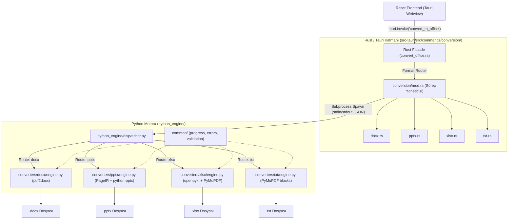
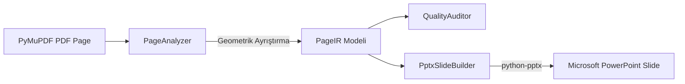
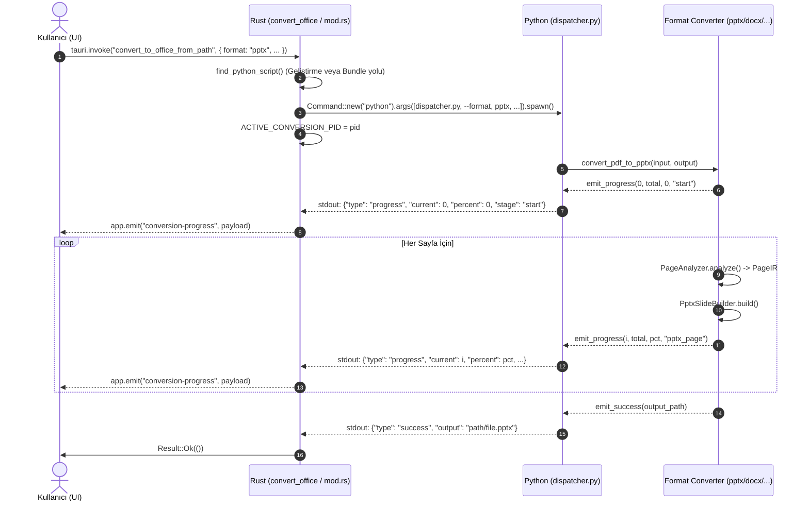

# PDFKit — Dosya Dönüştürme Motorları Modüler Mimari Tasarımı

Bu belge, PDFKit projesinin dosya dönüştürme sisteminde (PDF → DOCX, PPTX, XLSX, TXT) kurulan **tamamen modüler, birbirinden bağımsız ve yerel (offline)** mimarisini detaylandırmaktadır.

---

## 1. Mimari Tasarım Felsefesi ve Temel Hedefler

1. **Format İzolasyonu (Strict Isolation):**
   * Bir formata (örneğin PPTX) ait dönüştürme mantığı, geometrik analiz veya kütüphane yükseltmesi, diğer formatların (DOCX, XLSX, TXT) davranışını ve kararlılığını **kesinlikle etkilemez**.
2. **Çift Katmanlı Güvenlik (Rust + Python):**
   * Rust tarafında süreç yönetimi (PID takibi, anında iptal/taskkill), girdi/çıktı doğrulaması ve yerel şablon geri çekilme (fallback) mekanizması bulunur.
   * Python tarafında yüksek doğruluklu sayfa analizi ve belge üretimi çalışır.
3. **Tek Yönlü IPC & Canlı İlerleme İletişimi:**
   * Python motoru `stdout` üzerinden yapılandırılmış JSON nesneleri (`progress`, `success`, `error`) yayar; Rust bu akışı satır satır ayrıştırıp anlık olarak Tauri frontend'ine (React) aktarır.



---

## 2. Klasör ve Dosya Haritası: "Ney Nerede, Neyin İçinde?"

### A. Proje Kök Dizini (`/`)

```text
PDFKit/
├── src-tauri/                      # Rust / Tauri arka uç kodları
│   ├── Cargo.toml                  # Rust bağımlılıkları
│   ├── tauri.conf.json             # Tauri konfigürasyonu (scripts/**/* kaynak tanımları)
│   ├── scripts/                    # Paketleme ve dağıtım dizini (Tauri bundle)
│   │   ├── pdf2docx_engine.py      # Geriye dönük uyumluluk shim'i (dispatcher'a delege eder)
│   │   └── python_engine/          # Üretim paketi için python_engine aynası
│   └── src/
│       ├── commands/
│       │   ├── convert_office.rs   # Frontend IPC giriş kapısı (Facade)
│       │   └── conversion/         # Formatlara ayrılmış bağımsız Rust modülleri
│       │       ├── mod.rs          # Ortak süreç yönetimi, PID iptali, XML sanitization
│       │       ├── docx.rs         # DOCX'e özel Rust koordinatörü & geri çekilme
│       │       ├── pptx.rs         # PPTX'e özel Rust koordinatörü & OpenXML motoru
│       │       ├── xlsx.rs         # XLSX'e özel Rust koordinatörü & XML üreticisi
│       │       └── txt.rs          # TXT'e özel Rust koordinatörü & UTF-8 üreticisi
│
├── python_engine/                  # Bağımsız Python Dönüşüm Motoru Çekirdeği
│   ├── __init__.py                 # Paket tanımı
│   ├── dispatcher.py               # Komut satırı CLI giriş noktası ve format yönlendiricisi
│   ├── common/                     # Tüm motorların ortak kullandığı yardımcılar
│   │   ├── __init__.py
│   │   ├── progress.py             # Canlı JSON ilerleme ve XML temizleme protokolü
│   │   ├── errors.py               # Standart JSON hata emisyonu
│   │   ├── input_validation.py     # PDF varlığı ve çıktı yolu güvenlik denetimleri
│   │   └── pdf_inspection.py       # Şifreleme, sayfa sayısı ve metin yoğunluğu tespiti
│   └── converters/                 # Format motorları (HER BİRİ BAĞIMSIZ MODÜL)
│       ├── docx/                   # PDF → DOCX Motoru
│       │   ├── __init__.py
│       │   ├── engine.py           # pdf2docx + python-docx orkestrasyonu
│       │   └── patches.py          # pdf2docx font/paragraf uyumluluk yamaları
│       ├── pptx/                   # PDF → PPTX Motoru (Yüksek Doğruluklu IR Mimarisi)
│       │   ├── __init__.py
│       │   ├── engine.py           # PPTX ana giriş fonksiyonu ve orkestratör
│       │   ├── ir.py               # Ara Temsil modelleri (Rect, TextSpanIR, TableIR, vb.)
│       │   ├── analyzer.py         # PyMuPDF geometrik analizör (Çizim, tablo, callout)
│       │   ├── layout.py           # Çoklu sütun tespiti, okuma sırası ve metin kutusu metrikleri
│       │   ├── pptx_builder.py     # IR modelinden python-pptx slayt üretimi
│       │   └── quality.py          # Sayfa kalite denetimi (metin çakışması, düzenlenebilirlik)
│       ├── xlsx/                   # PDF → XLSX Motoru
│       │   ├── __init__.py
│       │   └── engine.py           # Tablo algılama ve openpyxl hücre eşleme motoru
│       └── txt/                    # PDF → TXT Motoru
│           ├── __init__.py
│           └── engine.py           # Doğal okuma sırasına göre UTF-8 metin çıkarma
│
└── tests/                          # Otomatik Doğrulama ve Entegrasyon Testleri
    ├── test_helpers.py             # Sentetik test PDF'leri üreten yardımcılar
    ├── docx/
    │   └── test_docx_engine.py     # DOCX motoru birim testleri
    ├── pptx/
    │   └── test_pptx_engine.py     # PPTX motoru, callout, diyagram ve defansif null testleri
    ├── xlsx/
    │   └── test_xlsx_engine.py     # XLSX motoru ve tablo testleri
    ├── txt/
    │   └── test_txt_engine.py      # TXT motoru ve UTF-8 testleri
    └── integration/
        └── test_dispatcher_integration.py # Biçim izolasyonu ve dispatcher testleri
```

---

## 3. Katmanların İç Yapısı ve Sorumlulukları

### A. Rust / Tauri Katmanı

1. **`commands/convert_office.rs` (Facade):**
   * Frontend tarafından çağrılan `convert_to_office` ve `convert_to_office_from_path` Tauri komutlarını karşılar.
   * Hedef biçime (`docx`, `pptx`, `xlsx`, `txt`) göre görevi ilgili alt modüle devreder.
2. **`commands/conversion/mod.rs` (Süreç ve İletişim Altyapısı):**
   * **Script Konumlandırma (`find_python_script`):** Hem geliştirme ortamındaki (`python_engine/dispatcher.py`) hem de paketlenmiş üretim ortamındaki (`scripts/python_engine/dispatcher.py`) script konumlarını sırayla denetler.
   * **Subprocess Yönetimi (`run_python_engine`):** Python sürecini başlatır, PID'sini `ACTIVE_CONVERSION_PID` atomik değişkenine yazar.
   * **Canlı İlerleme İletişimi:** Alt sürecin `stdout` akışını okur, JSON ilerleme bildirimlerini ayrıştırarak Tauri frontend'ine `conversion-progress` olayı olarak yayar.
   * **Anında İptal (`cancel_conversion`):** Kullanıcı "İptal Et" butonuna bastığında işletim sistemi seviyesinde (`taskkill /F /T /PID` veya `kill -9`) çalışan süreci ve çocuk süreçlerini anında sonlandırır.
3. **Format Modülleri (`docx.rs`, `pptx.rs`, `xlsx.rs`, `txt.rs`):**
   * Her biri yalnızca kendi dosya biçimine ait iş kurallarını barındırır.
   * Python motorunun bulunamadığı veya hata verdiği durumlarda devreye giren yerel şablon OpenXML/metin geri çekilme mekanizmalarını yönetir.

---

### B. Python Dönüştürme Motoru Katmanı

#### 1. Yönlendirici: `dispatcher.py`
Tauri tarafından çağrılan tek giriş noktasıdır:
```bash
python dispatcher.py --format pptx --input sample.pdf --output sample.pptx --pages 1,2,3
```
* Argümanları doğrular.
* İstenen format modülünün `convert_pdf_to_xxx` fonksiyonunu dinamik olarak çağırır.
* Hata oluştuğunda JSON formatında standart hata yayar ve uygun çıkış koduyla (`0` veya `1`) sonlanır.

#### 2. Ortak Yardımcılar: `common/`
* **`progress.py`:** `emit_progress(current, total, percent, stage)` ve `emit_success(output_path)` fonksiyonlarıyla Rust'a JSON satırları iletir. Ayrıca XML 1.0 geçersiz kontrol karakterlerini temizleyen `clean_xml_text()` fonksiyonunu sunar.
* **`errors.py`:** Hataları JSON yapısında standartlaştırır.
* **`input_validation.py`:** PDF'in diskte var olduğunu ve çıktı dizininin yazılabilir olduğunu denetler.

---

### C. PPTX Özel Mimarisi (IR Katmanı)

PPTX motoru, en karmaşık yerleşim mantığına sahip olan motordur ve **Intermediate Representation (IR)** katmanıyla modellenmiştir:



1. **`ir.py` (Ara Temsil Modelleri):**
   * `Rect`: 2B sınır kutusu (kesişim, kapsama, birleşim hesapları). `__post_init__` ile `None` veya geçersiz koordinatları güvenli float değerlere dönüştürür.
   * `TextSpanIR`, `TextLineIR`, `TextBlockIR`: Metin ve font hiyerarşisi.
   * `CalloutIR`: NOTE ve Uyarı kutularının dolgu, kenarlık ve iç metin temsili.
   * `DiagramIR`: Karmaşık vektörel ağların (diagram mesh) yüksek çözünürlüklü raster yedeği.
   * `TableIR`, `TableCellIR`: Tablo yapısal verisi.
   * Güvenli tip dönüştürücüler: `safe_float`, `safe_int`, `safe_color_rgb`, `safe_rect`.
2. **`analyzer.py` (`PageAnalyzer`):**
   * Sayfadaki çizimleri (`get_drawings`), tabloları (`find_tables`), resimleri ve metinleri tarar.
   * Renk profillerini (RGB, Grayscale, CMYK) ve kenar kalınlıklarını null-safe olarak çözer.
   * Diyagram bölgelerinde metin kopyalanmasını önlemek için **Duplicate Suppression** filtrelemesi uygular.
3. **`layout.py` (Yerleşim Motoru):**
   * Çok sütunlu sayfaları (`detect_column_split`) tespit eder. Sütunlar arası metinlerin yanlış birleştirilmesini engeller.
   * Okuma sırasını (Header → Kolon 1 → Kolon 2 → Footer) topolojik olarak sıralar.
   * Metin kutularına PowerPoint font değişkenliği için güvenli genişlik tamponu ekler.
4. **`pptx_builder.py` (`PptxSlideBuilder`):**
   * Bağımsız `PageIR` modelini alır ve `python-pptx` nesnelerine dönüştürür.
   * Çizim sırası (Z-index): Callout arka planları → Diyagram görselleri → Resimler → Çizgiler → Tablolar → Düzenlenebilir Metin Kutuları.
5. **`quality.py` (`QualityAuditor`):**
   * Her sayfa için düzenlenebilirlik oranını (`editability_ratio`) ve olası metin kutusu çakışmalarını denetler.

---

## 4. Yaşam Döngüsü ve Veri Akışı Protokolü



---

## 5. Dağıtım ve Çalışma Zamanı Senkronizasyonu

* **Geliştirme Ortamı:** Rust, kök dizindeki `python_engine/dispatcher.py` dosyasını doğrudan çalıştırabilir.
* **Üretim / Kurulum Ortamı:** `src-tauri/tauri.conf.json` içerisinde `bundle.resources: ["scripts/**/*"]` tanımı mevcuttur. Bu sayede uygulama paketlendiğinde `src-tauri/scripts/python_engine` dizini uygulamanın kaynak klasörüne taşınır ve binary ile birlikte taşınabilir olarak dağıtılır.
